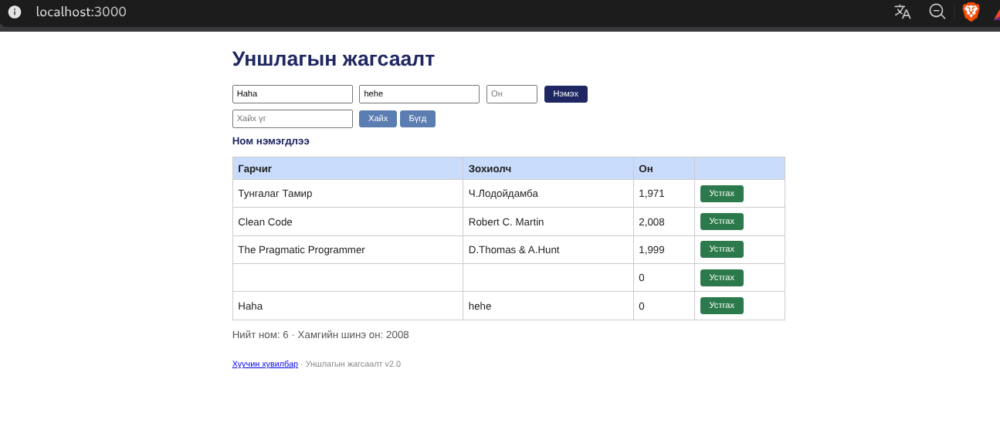

# BUG-01: «Нэмэх» товч хоосон талбартай номыг хүлээн авч, «Ном нэмэгдлээ» гэж мэдэгддэг

**Урьдчилсан нөхцөл:** `node app.js`-ийг шинээр асаасан (анхны 3 ном)

## Дахин гаргах алхам

1. `node app.js` ажиллуулж, браузераар `http://localhost:3000` нээ.
2. Гарчиг, Зохиолч, Он гурван талбарыг бүгдийг нь хоосон орхиод «Нэмэх» товч дар.
3. Дараа нь Гарчиг талбарт `Haha`, Зохиолч талбарт `hehe` бич, Он талбарыг хоосон орхиод «Нэмэх» дар.

**Хүлээгдэж байсан:** Спецификаци: «Ном нэмэхэд Гарчиг, Зохиолч, Он гурван талбар бүгд заавал бөглөгдсөн байх ёстой; дутуу бол ном нэмэгдэхгүй, ойлгомжтой алдааны мессеж харагдана.»
**Бодит үр дүн:** Хоёр тохиолдолд хоёуланд нь «Ном нэмэгдлээ» мессеж гарч, хүснэгтэд шинэ мөр нэмэгдэв. 2-р алхамд бүх утга хоосон мөр, 3-р алхамд `Haha` / `hehe` мөр үүсч, Он баганад хоёуланд нь `0` харагдана. Алдааны мессеж гараагүй.
**Ноцтой байдал:** Major. Өгөгдлийн үндсэн баталгаажуулалтын дүрэм зөрчигдөж, утгагүй мөр хадгалагдаж байна. Өгөгдөл алдагдах, аппын ажиллагаа зогсох зэрэг гол үйл ажиллагаанд нөлөөлөхгүй тул Critical биш.
**Хавсралт:** 
**Олдсон аялал:** Couch Potato (хоосон оролт)
