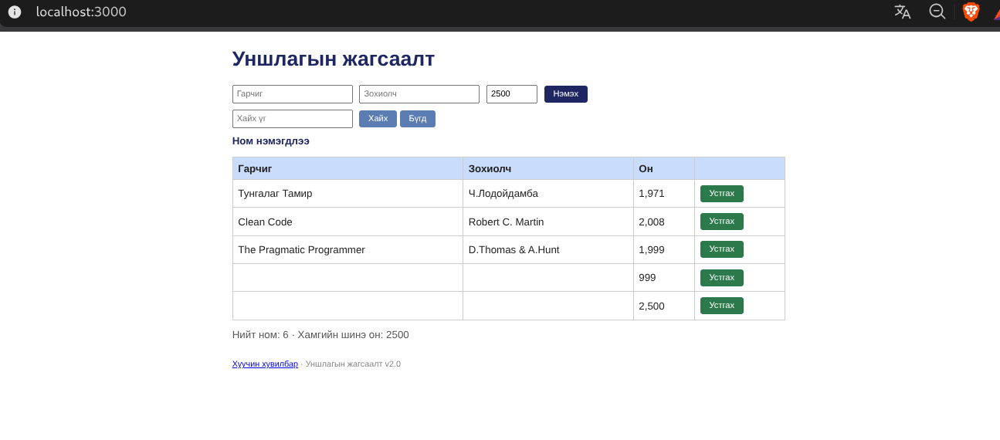

# BUG-02: Он талбар 1000-2100 хязгаарыг шалгадаггүй (999, 2500 хүлээн авдаг)

**Урьдчилсан нөхцөл:** `node app.js`-ийг шинээр асаасан (анхны 3 ном)

## Дахин гаргах алхам

1. `node app.js` ажиллуулж, браузераар `http://localhost:3000` нээ.
2. Гарчиг талбарт `Test`, Зохиолч талбарт `Tester`, Он талбарт `999` бич, «Нэмэх» дар.
3. Гарчиг талбарт `Test2`, Зохиолч талбарт `Tester`, Он талбарт `2500` бич, «Нэмэх» дар.

**Хүлээгдэж байсан:** Спецификаци: «Он нь 1000-2100 хоорондох бүхэл тоо.» Хязгаараас гадуурх утгад ном нэмэгдэхгүй, алдааны мессеж гарна.
**Бодит үр дүн:** Хоёр утга хоёулаа хүлээн авагдаж «Ном нэмэгдлээ» мессеж гарав. Хүснэгтэд `999` ба `2,500` гэсэн мөрүүд нэмэгдэж, «Хамгийн шинэ он» нь `2500` болов.
**Ноцтой байдал:** Major. Баталгаажуулалтын дүрэм зөрчигдөж, буруу өгөгдөл хадгалагдаж байна. Статистик (Хамгийн шинэ он) ч буруу утгаар бодогдоно.
**Хавсралт:** 
**Олдсон аялал:** Couch Potato (хязгаараас гадуурх оролт)
