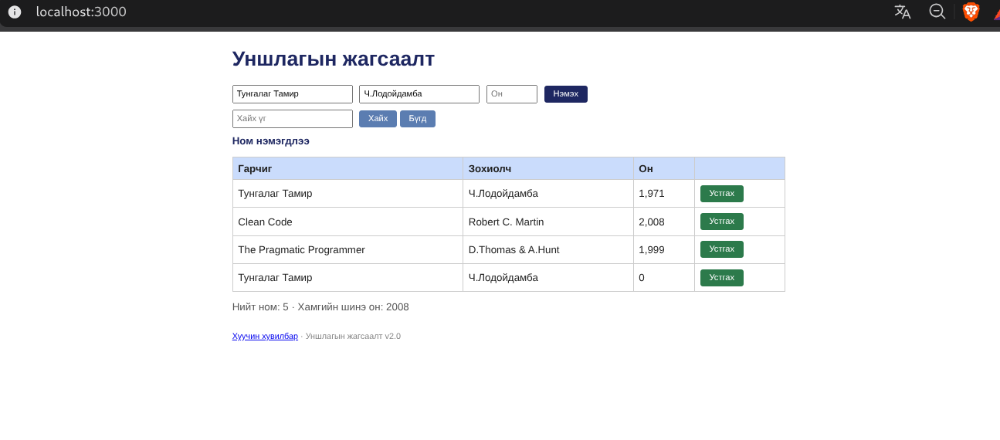

# BUG-03: Ижил гарчиг, зохиолчтой ном давхардаж нэмэгддэг

**Урьдчилсан нөхцөл:** `node app.js`-ийг шинээр асаасан (анхны 3 ном)

## Дахин гаргах алхам

1. `node app.js` ажиллуулж, браузераар `http://localhost:3000` нээ.
2. Гарчиг талбарт `Тунгалаг Тамир`, Зохиолч талбарт `Ч.Лодойдамба` бич. Он талбарыг хоосон орхи.
3. «Нэмэх» товч дар.

**Хүлээгдэж байсан:** Спецификаци: «Ижил гарчиг, зохиолчтой ном давхардуулж нэмэгдэхгүй.»
**Бодит үр дүн:** «Ном нэмэгдлээ» мессеж гарч, `Тунгалаг Тамир` / `Ч.Лодойдамба` гэсэн хоёр дахь мөр нэмэгдэв (Он баганад `0`). Давхардлын талаар анхааруулга гараагүй.
**Ноцтой байдал:** Major. Давхардсан өгөгдөл хадгалагдаж, жагсаалт буруу болно.
**Хавсралт:** 
**Олдсон аялал:** Couch Potato
