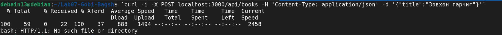

# BUG-04: «Нийт ном» тоолуур хүснэгтэд буй номын тооноос үргэлж 1-ээр илүү харагддаг

**Урьдчилсан нөхцөл:** `node app.js`-ийг шинээр асаасан (анхны 3 ном)

## Дахин гаргах алхам

1. `node app.js` ажиллуулж, браузераар `http://localhost:3000` нээ. Хүснэгтийн доорх «Нийт ном» тоог хүснэгтийн мөрийн тоотой харьцуул.
2. `Тунгалаг Тамир` мөрийн «Устгах» товч дар. Тоолуурыг дахин харьцуул.
3. `Clean Code` мөрийн «Устгах» товч дар. Тоолуурыг дахин харьцуул.

**Хүлээгдэж байсан:** Спецификаци: «Нийт ном» тоолуур хүснэгтэд буй номын тоотой тэнцүү.
**Бодит үр дүн:** Хүснэгтэд 3 мөр байхад «Нийт ном: 4», 1-р устгалын дараа 2 мөрөнд «Нийт ном: 3», 2-р устгалын дараа 1 мөрөнд «Нийт ном: 2» гэж харагдана. Тоолуур үргэлж бодит тооноос 1-ээр илүү. Мөн ном нэмсэн үед ч энэ зөрүү хэвээр (4 мөрөнд «Нийт ном: 5»).
**Ноцтой байдал:** Major. Хэрэглэгчид харагдах гол үзүүлэлт үргэлж буруу байна.
**Хавсралт:**  · бичлэг: [screenshots/bug-04.mp4](../screenshots/bug-04.mp4)
**Олдсон аялал:** Supermodel (GUI)
