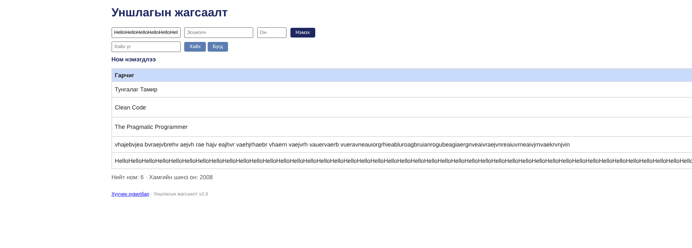

# BUG-05: Урт гарчигтай ном нэмэхэд хүснэгт дэлгэцээс хальж, бусад багана харагдахгүй болдог

**Урьдчилсан нөхцөл:** `node app.js`-ийг шинээр асаасан (анхны 3 ном)

## Дахин гаргах алхам

1. `node app.js` ажиллуулж, браузераар `http://localhost:3000` нээ.
2. Терминалд `python3 -c "print('Hello'*50)"` гэж ажиллуулж гарсан 250 тэмдэгтийг хуулж ав.
3. Гарчиг талбарт хуулсан тэмдэгтийг буулга, Зохиолч талбарт `A`, Он талбарт `2000` бич.
4. «Нэмэх» товч дар.

**Хүлээгдэж байсан:** Спецификаци: «Хүснэгт ямар ч урттай оролтод эвдрэхгүй.»
**Бодит үр дүн:** Хүснэгт хуудасны өргөнөөс хэт өргөсөж, баруун тал дэлгэцээс гарав. Зохиолч, Он баганууд болон «Устгах» товч харагдахгүй болж, хэвтээ гүйлгэх хэрэгтэй болов.
**Ноцтой байдал:** Minor. Хүснэгтийн зохион байгуулалт эвдэрч байгаа ч гүйлгэвэл «Устгах» товч хүртэх боломжтой, өгөгдөл алдагдахгүй.
**Хавсралт:** 
**Олдсон аялал:** Supermodel (урт оролтын эвдрэл)
